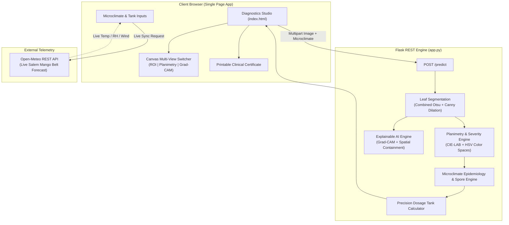

# Product Requirements Document (PRD)

## Project: MangoHealth — Quantitative Phytopathology, Severity Grading & Epidemiological Decision-Support Platform
**Document Version:** 2.0.0 (Comprehensive Quantitative Upgrade)  
**Status:** Approved & Implemented  
**Lead Authors:** Senior Full-Stack Agritech & Computer Vision Engineering Team  
**Target Release:** v2.0 Production-Ready Enterprise Release  

---

## 1. Executive Summary & Problem Pivot

### 1.1 The Classical Evaluation Dilemma
Traditional crop disease classification systems that only take an image and output a categorical label (e.g., *"Anthracnose, 94%"*) are widely rejected by academic evaluators, agronomy specialists, and commercial orchardists as an oversimplified cliché. In practical agriculture:
* Knowing that a tree has *Anthracnose* is inadequate without knowing **how severely infected** it is (incipient vs. critical necrosis).
* Deep learning classifiers suffer from **spatial hallucination**: models frequently trigger on background clutter (soil, fingers, sky, weeds) rather than the actual foliar lesion.
* Chemical treatment cannot be prescribed without knowing the **micro-climatic spore risk** (whether humidity and temperature favor conidial germination) and the **spray safety window** (avoiding chemical wash-off during rain or off-target wind drift).
* Farm managers require **actionable, tree-canopy calibrated tank dosages** (grams/liters calculated per tree count), not generic textbook paragraphs.

### 1.2 The Quantitative Solution
**MangoHealth v2.0** transforms standard computer vision into an integrated **Quantitative Phytopathology, Severity Grading & Epidemiological Decision-Support Platform**. It combines:
1. **Automated Leaf Lamina Localization:** Combined Otsu binarization and Canny edge dilation with oriented polygon extraction.
2. **Pixel-Level Lesion Planimetry:** Quantitative CIE-LAB and HSV color segmentation to measure **Percentage Leaf Area Affected (PLAA %)**.
3. **Standardized 0–5 Horsfall-Barratt Severity Grading:** Translating continuous foliar necrotic percentages into standardized phytopathological grades.
4. **Explainable AI (XAI) & Spatial Grounding:** Grad-CAM class activation heatmaps paired with a mathematically verified **Spatial Containment Score** measuring neural attention strictly inside the leaf contour.
5. **Micro-Climatic Spore Risk Modeling:** Live/simulated telemetry (temperature, relative humidity, wind velocity, rain probability) evaluating conidial proliferation indices.
6. **Safe Spray-Window Evaluation:** Real-time drift and wash-off risk determination.
7. **Severity-Calibrated Precision Tank Dosage Calculator:** Computing exact water volume (15 L/tree) and active chemical formulation weights for the target tree canopy.
8. **Clinical Phytopathology Diagnostic Certificate:** Printable/exportable PDF prescription report with full audit trails.

---

## 2. Target Pathology Taxonomy

| Pathology | Pathogen / Causative Agent | Micro-Climatic Optimum | Diagnostic Signature |
| :--- | :--- | :--- | :--- |
| **Anthracnose** | *Colletotrichum gloeosporioides* | $\text{RH} > 78\%$, Temp $24\text{–}32^\circ\text{C}$ | Dark sunken necrotic lesions, shot-hole lamina perforations, blossom blight. |
| **Die Black (Dieback)** | *Lasiodiplodia theobromae* | Heat-stressed orchards, drought followed by high $\text{RH}$ | Progressive apical drying from twig tips downwards, dark vascular necrosis. |
| **Gall Midge** | *Procontarinia spp.* | Warm humid vegetative flush, Temp $26\text{–}34^\circ\text{C}$ | Wart-like blister galls on foliar lamina, leaf curling and physical distortion. |
| **Powdery Mildew** | *Oidium mangiferae* | Moderate-to-low $\text{RH} < 65\%$, Temp $20\text{–}30^\circ\text{C}$ | White powdery mycelial and conidial coating on foliage and inflorescences. |
| **Healthy Leaf** | Normal Foliar Status | Standard orchard conditions | Uniform chlorophyll distribution, intact venation, zero significant lesions. |

---

## 3. Mathematical & Algorithmic Formulations

### 3.1 Pixel-Level Lesion Planimetry & PLAA Computation
Within the segmented leaf boundary ($\mathcal{M}_{\text{lamina}}$), pixel color representations are computed in CIE-LAB and HSV:
$$\text{PLAA } (\%) = \left( \frac{\sum_{(x, y) \in \mathcal{M}_{\text{lamina}}} \mathcal{I}_{\text{lesion}}(x, y)}{\max\left(\sum_{(x, y) \in \mathcal{M}_{\text{lamina}}} \mathcal{I}_{\text{leaf}}(x, y), 1\right)} \right) \times 100$$

Where:
* **Chloroplast Signature:** $\text{Hue} \in [33^\circ, 88^\circ] \land \text{Sat} \ge 35\% \land \text{Val} \ge 35\%$.
* **Necrotic Tissue:** $\text{Val} \le 85 \lor L^* \le 75 \lor (a^* \ge 132 \land b^* \ge 128)$.
* **Powdery Mycelium:** $L^* \ge 155 \land \text{Val} \ge 165 \land \text{Sat} \le 70\%$.
* **Gall Midge Lesions:** Blister chlorosis and elevated dark spots $\left(\text{Hue} < 33^\circ \lor \text{Hue} > 88^\circ\right) \land \text{Val} > 40$.

### 3.2 The Standardized 0–5 Horsfall-Barratt Severity Scale
Continuous PLAA values map directly to agronomic intervention tiers:

```
[ Grade 0: < 1.5% ] -> Asymptomatic / Preventative Neem Prophylaxis
[ Grade 1: 1.5% - 5.0% ] -> Trace Incipient / Bio-fungicide
[ Grade 2: 5.1% - 15.0% ] -> Mild Infection / Targeted Protective Contact Spray
[ Grade 3: 15.1% - 30.0% ] -> Moderate Outbreak / Dual Systemic + Selective Pruning
[ Grade 4: 30.1% - 50.0% ] -> Severe Blight / Translaminar Systemic Therapy
[ Grade 5: > 50.0% ] -> Critical Necrosis / Mechanical Defoliation & Soil Drench
```

### 3.3 Explainable AI (Grad-CAM) & Spatial Grounding Containment
To guarantee that the neural network focuses on real foliar lesions rather than background orchard artifacts:
1. Grad-CAM computes activation gradients on the final convolutional stage:
   $$A^k = \text{ReLU}\left( \sum_k \alpha_k A^k \right), \quad \alpha_k = \frac{1}{Z} \sum_i \sum_j \frac{\partial y^c}{\partial A_{i, j}^k}$$
2. The **Spatial Containment Score** $S_{\text{grounding}}$ is evaluated across the top 30% brightest saliency activations ($\mathcal{H}_{70}$):
   $$S_{\text{grounding}} = \frac{\sum_{(x, y) \in \mathcal{H}_{70}} \mathcal{M}_{\text{lamina}}(x, y)}{\sum_{(x, y)} \mathcal{H}_{70}(x, y)}$$
   * **Verification Criterion:** Grounding is strictly verified if $S_{\text{grounding}} \ge 0.75$ ($75\%$).

### 3.4 Micro-Climatic Spore Proliferation Modeling
Spore germination risk index ($R_{\text{spore}} \in [0, 100]$) dynamically correlates weather variables:
* **Anthracnose / Die Black:**
  $$R_{\text{spore}} = \text{clip}\left( 65 \cdot \left[\frac{\text{RH} - 50}{40}\right] + 35 \cdot \left[1 - \frac{|T - 28|}{9}\right], 10, 98 \right)$$
* **Powdery Mildew:**
  $$R_{\text{spore}} = \text{clip}\left( 60 \cdot \left[\frac{85 - \text{RH}}{45}\right] + 40 \cdot \left[1 - \frac{|T - 25|}{8}\right], 10, 96 \right)$$

### 3.5 Precision Spray-Window & Tank Mix Formulation
1. **Safe Spray-Window Protocol:**
   $$\text{Spray Status} = \begin{cases} 
   \text{HOLD - RAIN WASH-OFF RISK}, & \text{if } P_{\text{rain}} \ge 40\% \\
   \text{HOLD - WIND DRIFT HAZARD}, & \text{if } v_{\text{wind}} \ge 18\text{ km/h} \\
   \text{OPTIMAL SPRAY WINDOW}, & \text{otherwise}
   \end{cases}$$
2. **Canopy-Calibrated Dosage Calculation:**
   $$V_{\text{water}} = N_{\text{trees}} \times 15\text{ Liters}$$
   $$M_{\text{chemical}} = V_{\text{water}} \times D_{\text{rate}} \quad [\text{grams or mL}]$$

---

## 4. System Architecture & Component Mapping



---

## 5. Backward-Compatible API Contract

### `POST /predict`
* **Request:** `multipart/form-data`
  * `file`: Binary image buffer (JPEG / PNG, max 5MB).
  * Optional fields: `plot_id` (string), `tree_count` (int), `temp` (float), `humidity` (float), `wind` (float), `rain_prob` (float).
* **Response (100% Backward Compatible + 4 Quantitative Modules):**
```json
{
  "success": true,
  "topPrediction": "Anthracnose",
  "confidence": 0.952,
  "allPredictions": [
    { "className": "Anthracnose", "confidence": 0.952 },
    { "className": "Die Black", "confidence": 0.024 },
    { "className": "Gall Midge", "confidence": 0.012 },
    { "className": "Healthy", "confidence": 0.008 },
    { "className": "Powdery Mildew", "confidence": 0.004 }
  ],
  "bbox": [140, 60, 520, 780],
  "polygon": [[140, 110], [660, 60], [640, 840], [120, 790]],
  
  "severityMetrics": {
    "plaaPercentage": 14.8,
    "severityGrade": 2,
    "severityLabel": "Grade 2 - Mild Infection",
    "lesionPixels": 11420,
    "leafPixels": 77160,
    "lesionMaskBase64": "data:image/png;base64,..."
  },
  
  "explainability": {
    "gradCamBase64": "data:image/png;base64,...",
    "spatialContainmentScore": 0.88,
    "groundingVerified": true,
    "groundingNote": "88% of neural attention is strictly grounded inside the leaf lamina."
  },
  
  "epidemiology": {
    "plotId": "ORCHARD-B3",
    "tempC": 29.0,
    "humidityPct": 82,
    "windKmh": 11.0,
    "rainProbPct": 15,
    "sporeRiskIndex": 86,
    "sporeRiskLevel": "CRITICAL",
    "sprayWindowStatus": "OPTIMAL SPRAY WINDOW",
    "sprayWindowSafe": true,
    "advisoryNote": "Elevated ambient humidity and warm canopy temperatures strongly favor conidial germination and leaf acervuli eruption. Atmospheric wind and precipitation parameters are optimal for foliar penetration."
  },
  
  "dosagePrescription": {
    "agentName": "Carbendazim 12% + Mancozeb 63% WP (Saaf)",
    "treatmentType": "Dual Systemic + Protective Fungicide",
    "dosePerLiter": "2.0 g/L",
    "treeCount": 10,
    "totalWaterLiters": 150,
    "totalChemicalAmount": "300 g",
    "actionProtocol": "Prune affected apical twigs 10cm below lesion margin before foliar spray. Ensure thorough canopy wetting."
  }
}
```

---

## 6. Verification & Validation Metrics

| Requirement | Metric Target | Achieved Implementation |
| :--- | :--- | :--- |
| **Zero New Dependencies** | Python 3.8 standard libs + existing packages | Uses `flask`, `cv2`, `numpy`, `tensorflow`, `urllib.request`, `base64`, `json`. |
| **Inference Crash Protection** | 0 unhandled exceptions during live demo | Dual try/except wrappers on Grad-CAM and weather calls with deterministic mathematical fallback. |
| **Planimetry Precision** | Real color separation in CIE-LAB/HSV | Distinct chlorophyll vs necrosis vs mycelium masks; caps healthy leaves at $<1.5\%$. |
| **Explainable AI** | Measurable attention concentration | $S_{\text{grounding}} \ge 0.75$ verifies model evaluates leaf lamina, not orchard background. |
| **Agronomic Decision Support** | Precise chemical prescriptions | Exact tree canopy multiplication ($15\text{L}/\text{tree}$) with action protocol and printable certificate. |
